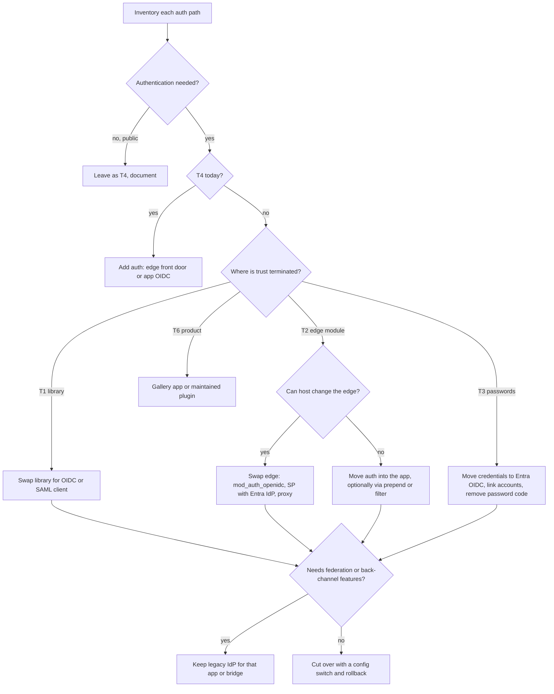

# Integration scenarios and choosing the refactoring approach

Use this before choosing a recipe. The question is not "which language" but **where the app gets its identity from and who terminates trust**. Language only decides which library or module implements the chosen pattern.

Status of the evidence: the patterns marked **validated** were run in this repo's demo tenant (reports in `samples/docs/*-ENTRA-VALIDATION.md`). Everything else is derived from vendor documentation and is marked **design**; confirm library names, versions and maintenance status before relying on them (**verify**).

## 1. Classify the app: trust boundary first

| Class | Who authenticates the user | What the app sees | Typical signals (grep for) |
|---|---|---|---|
| **T1 App-terminated protocol** | The app's own client library validates a CAS ticket, SAML response or OIDC token | A session the library created | `phpCAS::`, `org.apereo.cas.client` / `org.jasig.cas.client`, `django_cas_ng`, `passport-cas`, `omniauth-cas`, `go-cas`; SAML/OIDC: `SimpleSAML`, `OneLogin\Saml2`, `saml2Login()`, `oauth2Login()`, `mozilla_django_oidc`, `openid-client`, `omniauth-saml` |
| **T2 Edge-terminated** | A web-server module, agent or reverse proxy authenticates; the app only reads variables or headers | `REMOTE_USER`, `HTTP_SHIB_*`, `eppn`, `X-Remote-User`, Tomcat request attributes | `AuthType CAS` / `CASLoginURL` (mod_auth_cas), `AuthType shibboleth`, `ShibRequireSession`, `ShibUseHeaders`, `shibboleth2.xml`, `<Location>` blocks, `request.getRemoteUser()`, `Request.ServerVariables["eppn"]`, `RemoteUserMiddleware` |
| **T3 Credential-handling** | The app itself checks a password | The password | `ldap_bind(`, `ldap_connect(`, `python-ldap`, `ldapjs`, `LdapAuthenticationProvider`, `password_verify(`, `$_POST['password']`, `.htpasswd` / `AuthType Basic`, `<authentication mode="Forms">`, Windows/Kerberos auth in IIS |
| **T4 None** | Nobody | Anonymous users | No login route; maybe IP allow-lists or an unlisted URL |
| **T5 Already SAML/OIDC** | The app (T1) or an edge module (T2) against another IdP | Same as T1/T2 | `OIDCProviderMetadataURL`, `Sustainsys.Saml2`, `passport-saml`, `crewjam/saml`, `pac4j` |
| **T6 Packaged product / SaaS / CMS** | The product (vendor-hosted or a plugin) | Product session | Drupal, WordPress, Moodle, Joomla, Zoom, LMS, vendor consoles |
| **T7 Service-to-service / non-browser** | Tickets, tokens or passwords sent by scripts | Proxy tickets, REST tickets, basic credentials | CAS `/v1/tickets`, proxy-granting tickets (`pgtUrl`), SAML ECP, cron jobs with passwords |

An app can be several classes at once (a T1 login plus a T7 REST client). Inventory each path separately.

## 2. Questions that decide the approach

Ask in this order. Stop at the first answer that fixes the strategy.

1. **Should it be authenticated at all?** Public content with no personal data stays T4 on purpose. A "secret URL", IP allow-list or Basic auth is T3/T4 and should be treated as a gap, not as authentication.
2. **Can you change and redeploy the code?** If not (vendor, abandoned, no build), prefer an edge change or a product plugin over editing code.
3. **Where is trust terminated?** (section 1). T2 means the app trusts variables the edge sets: confirm they cannot be forged (section 4).
4. **What can the host run?** Shared hosting (cPanel) normally allows no Apache modules, daemons or root; containers, VMs and PaaS allow modules, sidecars and platform auth.
5. **Which protocol features are in use?** Back-channel logout, CAS proxy tickets, SAML attribute queries, non-browser clients, multi-IdP federation (InCommon/eduGAIN). Entra has no equivalent for several of these (section 6).
6. **Who are the users?** Campus workforce and students map to Entra users. Alumni, applicants, parents and partners need B2B guests or Entra External ID (**verify** licensing and features) and must be decided before coding.
7. **How is authorization expressed and keyed?** Affiliation, groups, attributes, local role tables; the account-link key (`uid`, email, `eppn`). See [claims-and-attributes](./claims-and-attributes.md).
8. **Retire or transition?** Retire the legacy IdP: change every app. Keep it for a while: bridge.

## 3. Strategies

| | Name | Use when | App change |
|---|---|---|---|
| **A** | Direct re-integration | You own the code and want to retire CAS/Shibboleth/LDAP | Replace the protocol client (T1), or add one (T3, T4) |
| **B** | Bridge | Many apps, no time, or vendor apps: legacy IdP delegates to Entra | None |
| **C** | Edge swap | T2: the app trusts server variables and hosting lets you change the edge | None if attribute names are preserved; identity helper if not |
| **D** | Front door | T4 or unmodifiable apps: platform or proxy authentication in front of the app | None to little |
| **E** | Keep for federation | Apps whose users arrive through a research federation | None; plan separately |

Preference order when more than one fits: **C or D (no code) over A over B**, unless the goal is retirement, in which case A. B is the lowest-effort start but leaves two identity systems to run and makes logout and MFA enforcement harder (see the [bridge recipe](./recipe-legacy-idp-bridge.md)).

## 4. Edge-terminated (T2) in detail: CAS and Shibboleth modes

### Shibboleth SP integration modes

| Mode | How the app reads identity | Replace with Entra by | Risk to check |
|---|---|---|---|
| **Native web-server module + `shibd`** (Apache `mod_shib`, IIS native module, nginx via FastCGI authorizer/responder) with **environment variables** | `$_SERVER`, `Request.ServerVariables`, `os.environ` | Keep the SP, replace the IdP with Entra (validated: [IIS recipe](./recipe-shibboleth-sp-iis.md)); change attribute IDs, not the module | Attribute policy removes `eppn`/`affiliation` without `shibmd:Scope`; Entra metadata has none |
| Same, with **HTTP headers** (`ShibUseHeaders On`, `useHeaders="true"`) | `HTTP_SHIB_*` / `X-` headers | Same, but fix the header trust first | **Headers can be forged** if the app is reachable without the SP, or if the SP does not strip inbound copies. Treat as a defect to fix, not a pattern to copy |
| **AJP / servlet container** (Apache + `mod_proxy_ajp` to Tomcat) | `request.getAttribute("eppn")`, `getRemoteUser()` | Keep the SP with Entra as IdP, or replace the front end with `mod_auth_openidc` | `ShibUseHeaders Off`, restrict the AJP connector with a secret and to loopback |
| **Reverse proxy or sidecar SP in front of containers** | Headers on a private network | Entra as IdP of that SP, or `oauth2-proxy` / `mod_auth_openidc` in the same position | App must listen only on the private network |
| **App-side SAML library** talking to a Shibboleth IdP (no SP software) | Library session | Change IdP metadata, entity ID and claims mapping (config only for T5) | NameID format, signing and encryption flags (see the [Drupal recipe](./recipe-drupal-samlauth.md), validated) |
| **Session JSON/API** (`/Shibboleth.sso/Session`, SPAs calling it) | JSON from the SP | Keep with Entra as IdP; never show attribute values to the browser (**verify** current handler options) | `showAttributeValues` on, open `Status` handler |
| **Lazy sessions** (`requireSession=false`, app links to `/Shibboleth.sso/Login`) | Variables only after login | Keep the SP; the login link is unchanged | Public pages must not assume an identity |
| **Attribute query, SOAP logout, ECP** | Back-channel | Entra supports none of these; redesign (OIDC, Graph, OAuth tokens) | No direct replacement |
| **Federation SP** (many IdPs, discovery service, entity categories) | Variables | Entra alone does not behave like a federation of IdPs: choose scenario E and decide which IdP represents the institution (**verify**) | Silently dropping federated external users |

### CAS integration modes

| Mode | How it works | Entra target | Notes |
|---|---|---|---|
| **Client library** (filter, middleware, `phpCAS`) | Ticket validation, session in the app | OIDC authorization-code client (A) | validated for Spring Boot and PHP |
| **Apache `mod_auth_cas`** | Module sets `REMOTE_USER`, `CAS_*` | `mod_auth_openidc` with the same `Require` rules (C), or app-side OIDC when no module can be installed | No Entra CAS endpoint exists |
| **CAS as OIDC/SAML provider to the app** | The app already speaks OIDC or SAML to CAS | Point the same client at Entra; remap claims (T5) | Claim names come from CAS today (`preferred_username`, `uid`) |
| **CAS proxy tickets (PGT)** | Middle tier calls a backend as the user | Not available. Use OAuth 2.0 on-behalf-of or delegated tokens | Redesign, not a swap |
| **CAS REST protocol** (`/v1/tickets` with a password) | Script posts credentials | Client credentials (app role), device code, or managed identity | Do not use ROPC, which cannot satisfy MFA |
| **Back-channel SLO** (`/slo` POST) | CAS calls the app to end sessions | None. Use local logout + Entra end-session, shorter lifetimes | Document the behaviour change |
| **Service registry policies** (per-service MFA, attribute release) | CAS decides | Conditional Access per app + claims mapping + app roles | Move the policy, not just the login |

## 5. Entra target options

| Target | What it is | Good for | Limits |
|---|---|---|---|
| **OIDC client in the app** (authorization code + PKCE) | App validates tokens | Own code (A), preferred long term | Secrets and redirect URIs to manage |
| **SAML SP in the app or keep the SP** | Entra as SAML IdP | Drupal, Shibboleth SP, SaaS | Certificates, claim URIs |
| **Edge OIDC module** (`mod_auth_openidc`) or **proxy** (`oauth2-proxy`) | Authentication outside the app, claims as variables/headers | T2 apps, polyglot, legacy languages | Header trust; module must be installable |
| **Platform auth** (App Service / Container Apps "Easy Auth") | Platform authenticates, injects `X-MS-CLIENT-PRINCIPAL*` | Apps already on those platforms | Only on those platforms |
| **Entra Application Proxy / Private Access** | Pre-authenticated publishing of private apps; header-based SSO usually needs a partner product (**verify**) | On-prem or private apps that stay private | Not for internet-facing shared hosting |
| **WS-Federation / OWIN WsFederation** | Entra supports WS-Fed | ADFS-era .NET apps | Prefer OIDC or SAML for new work |
| **Entra Domain Services (LDAPS)** | Managed AD with LDAP | Stopgap for apps that cannot stop binding to LDAP | Not modernisation; password hash sync prerequisites (**verify**) |
| **Bridge** (CAS pac4j, Shibboleth IdP proxy) | Legacy IdP delegates | Transitional only | Two identity systems |

Entra provides **no CAS protocol, no general-purpose LDAP, no back-channel logout, no SAML attribute query**. Anything that depends on those needs redesign or a bridge.

## 6. Scenario recommendations (language-neutral)

| Scenario | Preferred | Fallback | Avoid | Change | Main risks |
|---|---|---|---|---|---|
| T1 CAS client library | A: OIDC client | B bridge | Wrapping the CAS client around Entra | Medium | Account-link key, logout |
| T2 CAS module (`mod_auth_cas`) | C: `mod_auth_openidc` | A: OIDC inside the app / prepend script | Keeping both modules active | Low to medium | Static files left unprotected; `REMOTE_USER` format |
| T2 Shibboleth SP (env variables) | C: keep SP, Entra as IdP | A | Editing attribute maps to reuse `eppn`/`affiliation` | Low | Scope policy, UPN suffix, logout |
| T2 Shibboleth SP (headers) | C after proving header trust | A | Copying the pattern to new apps | Low | Forgeable headers |
| T3 LDAP bind | A: OIDC, drop password handling | Domain Services LDAPS (stopgap) | ROPC | Medium to high | Directory lookups, account linking, MFA |
| T3 custom form + local table | A: OIDC with linking by immutable ID | Local login behind a flag during transition | Linking by unverified email | Medium | Password hashes cannot be imported into Entra (**verify**); users without an Entra account |
| T4 none, should be protected | D: front door (platform auth, proxy) | A: OIDC in the app | Adding app code without defining authorization | Low to medium | Static files, API routes outside the guard |
| T5 SAML/OIDC to another IdP | Re-point: metadata/authority + claims | None needed | Rebuilding the client | Low | NameID, roles claim name, certificate rollover |
| T6 product with SSO | Gallery app or maintained plugin | Bridge | Custom auth code in a product | Low | Plugin support, license tier |
| T7 proxy tickets / REST / scripts | OAuth 2.0 flows | Keep legacy for those clients | ROPC | High | Unknown consumers |

Tie-breakers: prefer the option with **no custom crypto or token validation in your code**, then the one that leaves **rollback as a configuration switch**, then the one that **retires** a legacy component.

## 7. Languages: patterns and targets

Libraries are examples to evaluate (**verify** maintenance and licence). The Entra column is the OIDC choice; SAML alternatives are in the next column.

| Language | CAS (T1 / T2) | Shibboleth (T2) | LDAP / form (T3) | Entra OIDC | SAML alternative |
|---|---|---|---|---|---|
| **PHP** | `phpCAS`; Apache `mod_auth_cas` | `mod_shib` env vars in `$_SERVER`, or headers | `ldap_bind`, `password_verify` | `jumbojett/openid-connect-php` (**validated**, vendored, force S256 PKCE), `league/oauth2-client` | SimpleSAMLphp, `onelogin/php-saml`; Drupal `samlauth` (**validated**) |
| **Java** | Apereo CAS client filters, Spring Security CAS | `mod_shib` + AJP request attributes | Spring LDAP, JAAS | Spring Security `oauth2Login()` (**validated**, HR pilot); pac4j as a stepping stone (it has CAS, SAML and OIDC clients) | Spring Security `saml2Login()` |
| **.NET Framework** | HttpModule/OWIN CAS client | IIS native SP: server variables (**validated** with Entra as IdP) | Forms, Windows/Kerberos in IIS | `Microsoft.Owin.Security.OpenIdConnect` (**design**) | Keep the native SP; Sustainsys.Saml2 |
| **.NET (Core)** | CAS middleware | SP behind a proxy | Identity + LDAP | `Microsoft.Identity.Web` (**design**) | Sustainsys.Saml2, ITfoxtec |
| **Python** | `django-cas-ng`, `python-cas` | `mod_wsgi` + `mod_shib`, `RemoteUserMiddleware` | `django-auth-ldap`, `ldap3` | Authlib, `mozilla-django-oidc`, `django-allauth` (**design**) | `python3-saml`, `djangosaml2` |
| **Node.js** | `passport-cas` | nginx + SP via FastCGI, headers | `ldapjs`, `passport-ldapauth` | `openid-client` (**design**); `@azure/msal-node` for tokens/Graph | `@node-saml/passport-saml` |
| **Ruby** | `omniauth-cas`, `rubycas-client` | Passenger behind `mod_shib` | `devise_ldap_authenticatable` | `omniauth-openid-connect` (**design**) | `omniauth-saml` |
| **Go** | `go-cas` | Reverse proxy headers | `go-ldap` | `coreos/go-oidc` + `x/oauth2` (**design**) | `crewjam/saml` |
| **Perl / classic ASP / ColdFusion / CGI** | Edge module | Edge module | Various | Do not write OIDC here: use the edge or a proxy (C or D) | Edge |
| **Packaged (CMS/LMS)** | Plugins | Plugins | Plugins | Maintained plugin (Drupal `openid_connect`, WordPress/Moodle OIDC plugins, **verify**) | Maintained SAML plugin |

Keep the **identity helper** the single place that reads identity (an adapter returning `uid`, `displayName`, `mail`, `roles`). When migrating, change only the adapter and the edge or library; leave authorization code alone by reusing role values.

## 8. Worked evaluation: PHP on cPanel

cPanel shared hosting usually gives you PHP, `.htaccess`, optional Composer or SSH, a per-user document root, and **no** custom Apache modules, daemons or root. Outbound HTTPS to `login.microsoftonline.com` and `graph.microsoft.com` must work (**verify**). Keep secrets in a file above `public_html` with mode 0600 (validated, see the [PHP recipe](./recipe-php-shared-hosting.md)).

| Scenario today | Recommended | Why | Watch for |
|---|---|---|---|
| **phpCAS** | A: vendored OIDC client, same identity helper | **Validated** (partially) in the Alumni pilot; no module needed | Force S256 PKCE, take `uid` from Graph `mailNickname`, back-channel `/slo` goes away |
| **`mod_auth_cas`** | If you cannot install modules: A, or an **`auto_prepend_file` bootstrap** (`.user.ini` for FPM/CGI, `php_value` in `.htaccess` for `mod_php`) that runs OIDC and sets the variables the app already reads. If you control Apache (VPS, WHM): `mod_auth_openidc` | Preserves the "app reads `REMOTE_USER`" contract with no per-page edits | **Static files and non-PHP routes are not protected by a PHP prepend**; serve them through PHP or move them out of the web root. Ensure only one of the two mechanisms is active (**design**) |
| **Direct LDAP** | A: OIDC, remove `ldap_bind` | The app should never see passwords. Directory lookups move to Graph with a delegated permission | People search and attribute needs; Domain Services LDAPS only as a stopgap |
| **Custom PHP form** | A: OIDC, keep the local users table for app data and link by `oid`/`sub` after a verified first sign-in; keep a disabled break-glass local login | Removes password storage and adds MFA and Conditional Access | Never link on unverified email; hashes cannot be imported into Entra (**verify**); external users need B2B/External ID |
| **Shibboleth headers** (an upstream SP sets `HTTP_SHIB_*` / `REMOTE_USER`) | C if the upstream SP is yours: change its IdP to Entra and the attribute IDs. If the headers come from nowhere you control, fix that first | Zero app change when names are preserved | First prove the headers cannot be forged (direct access to the origin, inbound header stripping). A cPanel host that has no SP in front is trusting headers any client can send |
| **Already SAML or OIDC** | T5: re-point to Entra (authority/metadata, client ID, claims, certificates); keep library | Config-only | `NameID` format, roles claim name, logout, key rollover |
| **No authentication** | First decide whether it should have any. If yes: A with the vendored OIDC client, define roles before code | A cPanel origin is internet-facing, so Application Proxy and platform auth do not apply | Every route (APIs, uploads, static) needs the guard |

Common cPanel traps: PHP version differences between CLI and web, `open_basedir`, session paths shared with other tenants (use a private session directory), `SameSite` cookies across the Entra redirect, Composer not allowed (vendor by hand with pinned hashes, as the pilot did), and cron jobs that authenticate with passwords (T7).

## 9. Assessment template

For each app, report:

1. **Inventory:** each auth path, its class (T1 to T7), the files and config that prove it, the user population, the account-link key, authorization source, and which legacy features are used (back-channel logout, proxy tickets, federation).
2. **Recommendation:** strategy (A to E), the specific Entra target, the library or module, and why the alternatives lose (use the tie-breakers).
3. **Change list:** files, settings, tenant objects (app registration or enterprise app, roles, claims), secrets and their home.
4. **Behaviour changes:** logout, session length, MFA, attribute availability, the UPN domain.
5. **Rollback:** the single switch that returns to the legacy path.
6. **Evidence:** what was run and observed versus what is **design**. Do not state that a migration works until login, a protected page, a role-denied page and logout were exercised in a browser against the real tenant.
